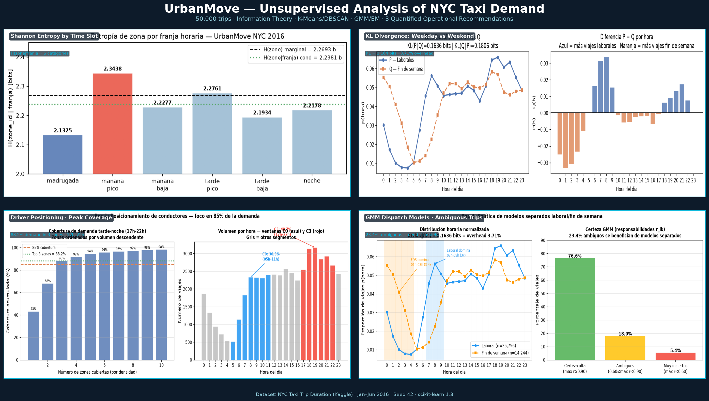
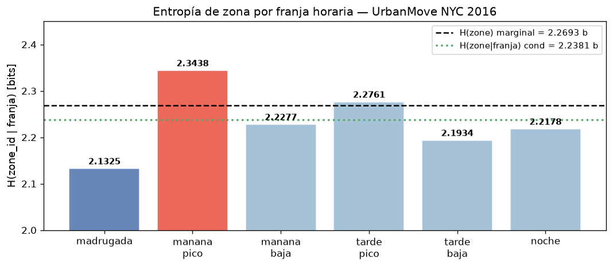
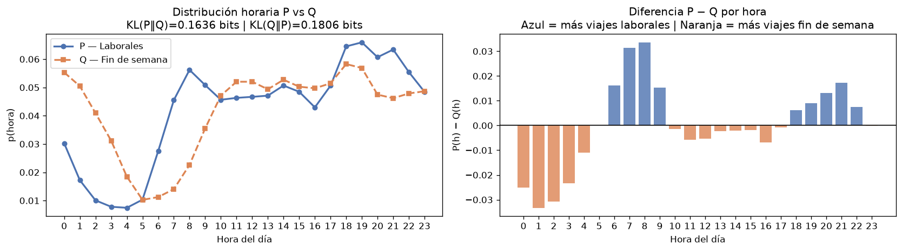
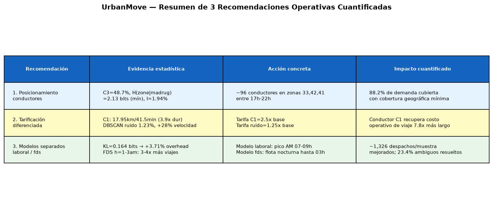
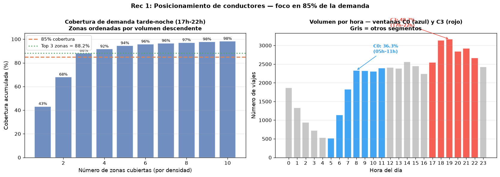
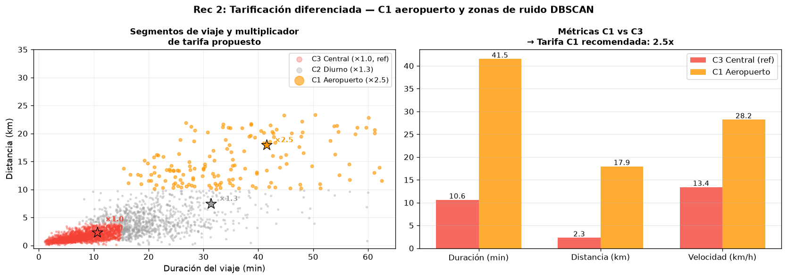
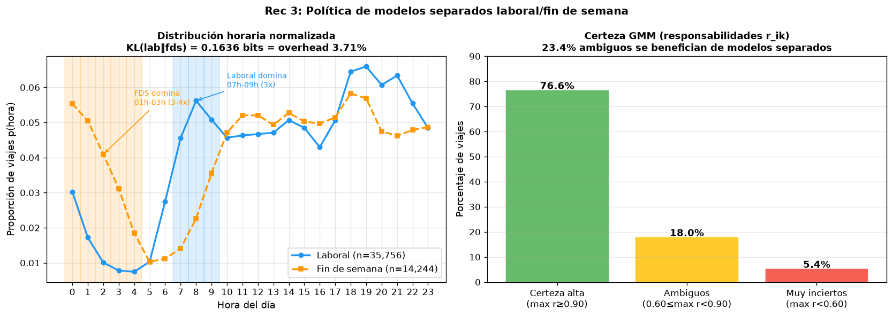

# UrbanMove — Patrones Invisibles en la Movilidad Urbana de NYC

   

**ML No Supervisado · Universidad de La Sabana**

> **Business impact en una línea:** Tres recomendaciones operativas cuantificadas — posicionamiento de conductores, tarificación diferenciada y modelos de despacho separados — derivadas de 1.4M viajes reales de taxi en NYC usando teoría de la información, clustering y mezclas gaussianas.

Análisis de consultoría para **UrbanMove**, una plataforma de movilidad en Nueva York que necesita saber qué tan predecible es la demanda por zona y hora, qué perfiles de viaje existen realmente y dónde posicionar a sus conductores. Aplicamos teoría de la información, clustering particional y modelos de mezcla gaussiana sobre viajes reales de taxi, y traducimos los resultados en tres recomendaciones operativas cuantificadas.



---

## Skills demostradas

`Unsupervised Learning` · `Information Theory` · `Gaussian Mixture Models` · `EM Algorithm` · `K-Means / DBSCAN` · `Geospatial Analysis (Haversine)` · `Shannon Entropy / KL Divergence / Mutual Information` · `Pandas` · `scikit-learn` · `Jupyter` · `LaTeX` · `python-pptx`

---

## Dataset

**NYC Taxi Trip Duration — Kaggle:** https://www.kaggle.com/c/nyc-taxi-trip-duration/data

1.458.644 viajes de taxi entre enero y junio de 2016, con hora y coordenadas de recogida y destino, número de pasajeros, proveedor y duración del viaje.

> El archivo `train.csv` no se incluye en el repositorio por su tamaño. Descárgalo de Kaggle y colócalo en `train/train.csv`.

### Limpieza y muestreo

Los criterios se definieron antes de filtrar:

| Criterio | Se conserva |
|---|---|
| Pasajeros | 1 a 6 |
| Duración | 60 s a 3 h |
| Recogida y destino | Dentro de NYC (lon −74,05 a −73,75; lat 40,48 a 40,92) |
| Distancia Haversine | ≥ 0,10 km |
| Velocidad media | ≤ 100 km/h |

- Se eliminaron **23.592 registros (1,62%)** y quedaron **1.435.052**. No había nulos ni IDs duplicados.
- **Muestra:** 50.000 viajes (3,43% del total) con **muestreo aleatorio estratificado por mes** (asignación proporcional) y **semilla 42**. La proporción mensual de la muestra replica la del dataset limpio (CV mensual 4,3%).
- **Variables derivadas:**
  - distancia Haversine (nunca euclidiana sobre lat/lon), duración en minutos y velocidad;
  - hora, día de la semana, mes e indicador de fin de semana;
  - franja horaria (6 categorías);
  - zona de recogida en una grilla de 8×8.

---

## Estructura del repositorio

```
├── README.md
├── requirements.txt
├── src/
│   ├── __init__.py
│   └── features.py          # haversine, assign_zone_grid, add_time_features, clean_trips
├── assets/
│   ├── dashboard.png         # Resumen visual del análisis completo
│   └── generate_dashboard.py # Script para regenerar el dashboard
├── notebooks/
│   ├── 00_data_prep.ipynb             # Limpieza, variables derivadas y muestra reproducible
│   ├── 01_informacion.ipynb           # Entropía, entropía condicional, MI, KL, log-sum-exp
│   ├── 02_clustering.ipynb            # K-Means y DBSCAN, validación y tratamiento del ruido
│   ├── 03_gmm_em.ipynb                # GMM, EM manual (E-step / M-step), inicializaciones
│   └── 04_negocio_integracion.ipynb   # Integración y recomendaciones para UrbanMove
├── data/
│   └── clean_sample.parquet           # Generado por 00_data_prep (50.000 viajes, seed=42)
├── docs/
│   ├── informe_urbanmove.pdf          # Informe completo
│   ├── informe_urbanmove.tex          # Fuente LaTeX del informe
│   ├── generar_informe_pdf.py         # Script para regenerar el PDF sin LaTeX instalado
│   └── *.png                          # Figuras generadas por los notebooks
├── entrega/
│   ├── key_findings_walkthrough.md    # Narrativa completa de hallazgos por bloque
│   ├── presentacion_urbanmove.pptx    # Presentación de diapositivas
│   └── generar_presentacion.py        # Script para regenerar el PPTX
└── train/
    └── train.csv                      # Descargar de Kaggle (no incluido)
```

---

## Cómo ejecutar

1. Instalar dependencias:
   ```bash
   pip install -r requirements.txt
   ```
   Los notebooks se ejecutaron con scikit-learn 1.3.0.

2. Descargar `train.csv` de Kaggle y colocarlo en `train/`.

3. Ejecutar los notebooks **en orden**, desde la carpeta `notebooks/`:
   - `00` genera `data/clean_sample.parquet`;
   - `01`, `02` y `03` leen esa muestra;
   - `04` integra los resultados.

4. Las funciones de feature engineering están disponibles como módulo:
   ```python
   from src.features import haversine, assign_zone_grid, add_time_features, clean_trips
   ```

> **Nota sobre rutas:** algunas celdas usan rutas relativas (`../data/clean_sample.parquet`). Si el notebook no encuentra el archivo, ajusta la ruta a la ubicación del parquet en tu máquina.

Todos los procesos aleatorios usan `SEED = 42` → resultados reproducibles.

---

## Resultados principales

### Bloque 1 — Teoría de la información

| Métrica | Valor | Lectura |
|---|---|---|
| H(zona) | 2,2693 bits (45% del máximo de 5,04) | Demanda moderadamente concentrada en 33 zonas activas |
| H(hora) | 4,4639 bits | Viajes repartidos a lo largo del día |
| H(zona \| madrugada) / H(zona \| mañana pico) | 2,1325 / 2,3438 bits | Madrugada = franja más predecible |
| H(zona \| franja) | 2,2381 bits | La franja reduce la incertidumbre solo 1,37% |
| I(hora ; zona) | 0,0440 bits = 1,94% de H(zona) | La hora sola casi no predice la zona |
| KL(laboral ‖ fin de semana) | 0,1636 bits (inversa: 0,1806) | Patrones horarios distintos |
| H(laboral, fin de semana) | 4,5760 bits = H(P) + KL | Sobrecosto de 3,71% con un modelo único |
| log-sum-exp en [−1000, −1001, −1002] | −999,5924 (suma ingenua: −∞) | Estabilidad numérica para el E-step |





### Bloque 2 — Clustering por partición

| Método | Parámetros | Clusters | Silueta | Ruido |
|---|---|---|---|---|
| K-Means (lon, lat, hora, duración; escalado) | K = 4, elegido por codo + silueta | 4 | 0,2916 | — |
| DBSCAN (lon, lat; submuestra de 20.000) | ε = 0,10, min_samples = 5 (gráfica k-distancia) | 23 | 0,0971 (sin ruido) | 247 (1,23%) |

| Cluster K-Means | % viajes | Hora media | Duración | Distancia |
|---|---|---|---|---|
| C0 Commuter mañana/madrugada | 36,3% | 6,9 h | 10,6 min | 2,64 km |
| C1 Aeropuerto / Periferia | 2,2% | 14,1 h | 41,5 min | 17,95 km |
| C2 Diurno largo | 12,8% | 14,4 h | 31,4 min | 7,46 km |
| C3 Tarde/Noche central | 48,7% | 18,3 h | 10,6 min | 2,29 km |

### Bloque 3 — Mezcla gaussiana y EM

- **Modelo final:** K = 4 (mínimo BIC = 116.936,9), covarianza completa, inicialización K-means++.
- **Convergió en 26 iteraciones**, log-verosimilitud −58.257,5.

| Perfil latente | π | Duración | Distancia | Velocidad |
|---|---|---|---|---|
| Micro-urbano rápido | 0,2707 | 5,66 min | 1,57 km | 16,34 km/h |
| Tráfico lento-corto | 0,2993 | 9,70 min | 1,55 km | 9,62 km/h |
| Commuter medio | 0,2528 | 18,43 min | 3,71 km | 12,32 km/h |
| Largo alta velocidad | 0,1772 | 27,80 min | 9,13 km | 22,75 km/h |

- **EM manual** (10 iteraciones): LL sube de −15.760,6 a −12.403,2 (+3.357), monótonamente.
- **K-means++ vs aleatorio:** LL −58.279,6 vs −59.549,2 — la aleatoria queda en un óptimo local peor.
- **Responsabilidades:** certeza media 92,1%; 23,4% de viajes ambiguos (r < 0,9).

---

## Recomendaciones para UrbanMove



**1. Posicionamiento de conductores.**
- Entre las 17 y las 22 h ocurre el 34,6% de los viajes, y las zonas 33, 42 y 41 (Manhattan central) concentran el **88,2%** de ellos.
- Con viajes de 10,6 min (5,7 viajes/conductor/hora) se requieren ~3 conductores simultáneos a escala de la muestra.



**2. Tarificación diferenciada.**
- Aeropuerto/periferia: **multiplicador 2,5×**. Zonas atípicas DBSCAN: **1,25×**.



**3. Dos modelos de despacho (laboral / fin de semana).**
- KL = 0,1636 bits → 3,71% de sobrecosto con modelo único → ~1.300 decisiones subóptimas sobre la muestra.
- Laboral: foco en picos 7–9 h y 17–21 h. Fin de semana: cobertura extendida hasta las 3 h.



### Limitaciones y siguientes pasos

- Datos de 2016 (prepandemia), solo enero–junio. Reentrenar con datos recientes de año completo.
- Sin variables de clima ni eventos (la hora explica solo 1,94% de la zona).
- GMM con colas gaussianas subestima viajes extremos → probar mezclas t de Student.
- Grilla 8×8 gruesa (~3,2 × 6,1 km por celda) → usar zonas TLC oficiales.
